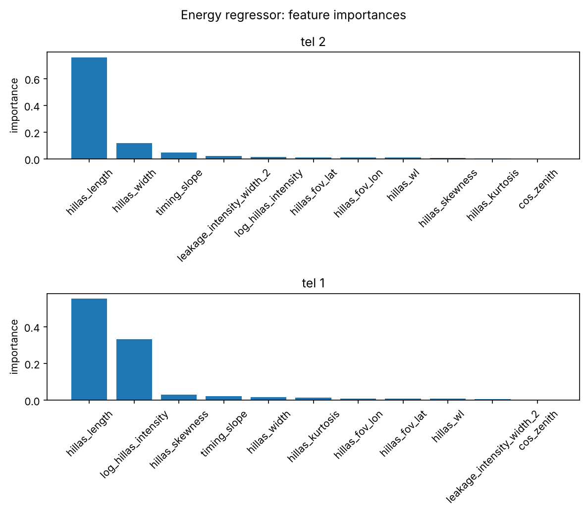
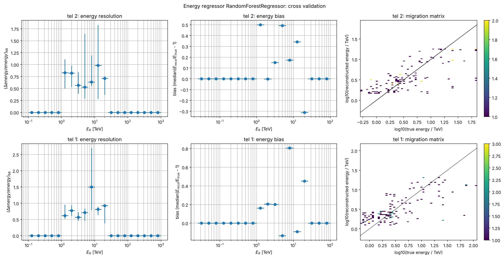
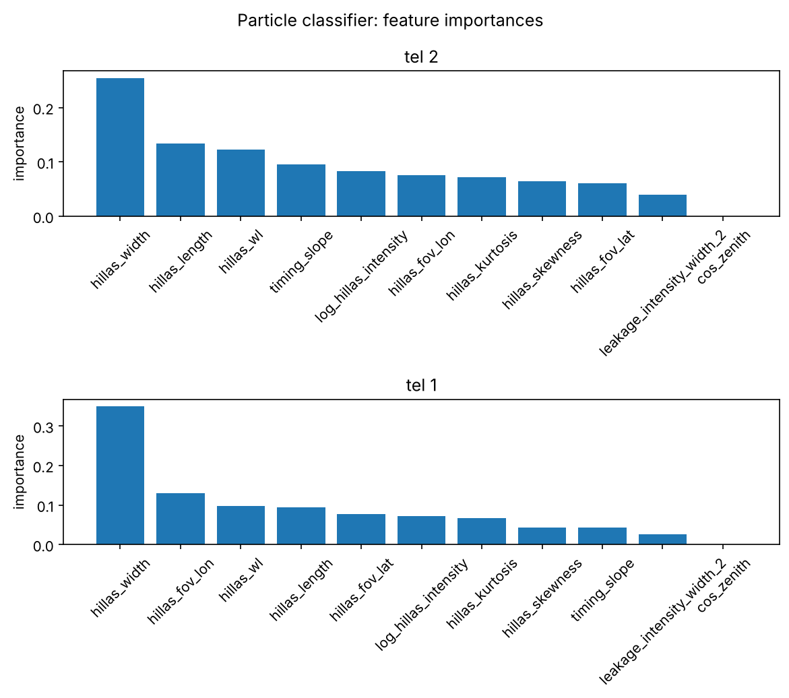
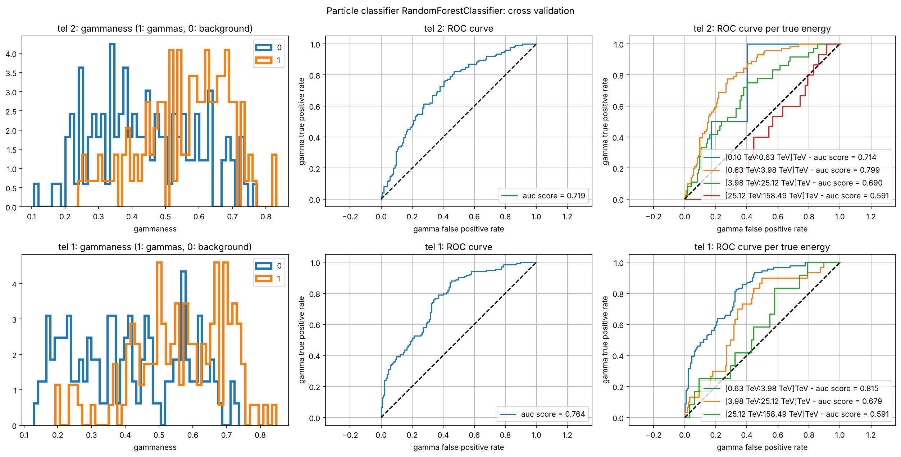
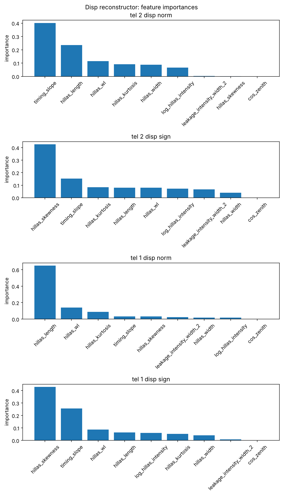
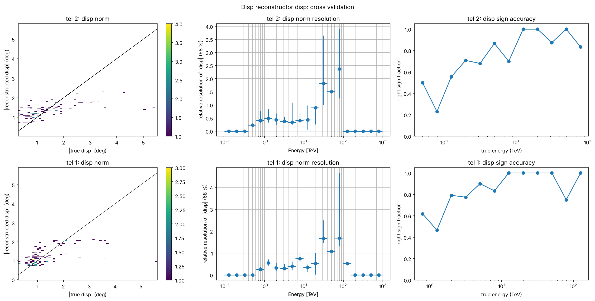

DL1 to DL2 with the ctapipe reconstructors
==========================================

The energy, the gamma/hadron separation (gammaness) and the direction of the events can be
reconstructed with the machine learning reconstructors of ctapipe (``ctapipe.reco``), trained and
applied by sst1mpipe tools built on the ctapipe tools. They have the options and configuration
sections of the ctapipe tools, and write the DL2 of ctapipe (tables and column names, e.g.
``RandomForestRegressor_energy``, ``RandomForestClassifier_prediction``, ``disp_alt``):

=======================================  =========================================  ===================================================
sst1mpipe tool                           ctapipe tool                               added by sst1mpipe
=======================================  =========================================  ===================================================
``sst1mpipe-train-energy-regressor``     ``ctapipe-train-energy-regressor``         plots: feature importances, energy resolution, bias
                                                                                    and migration matrix
``sst1mpipe-train-particle-classifier``  ``ctapipe-train-particle-classifier``      plots: feature importances, gammaness, ROC curves
                                                                                    (all energies and per true energy)
``sst1mpipe-train-disp-reconstructor``   ``ctapipe-train-disp-reconstructor``       plots: feature importances, disp norm, sign accuracy
``sst1mpipe-apply-models``               ``ctapipe-apply-models``                   pointing of the target if no telescope pointing
=======================================  =========================================  ===================================================

The stereo direction of the MARS analysis (``StereoMARSCombiner``) is available in all of them.

Input: DL1 with the telescope frame parameters
----------------------------------------------

The disp reconstructor and the intensity weights of the stereo combination use the Hillas
parameters in the telescope frame (``hillas_fov_lon``, ``hillas_fov_lat``, ``hillas_psi``,
``hillas_intensity``), written by the sst1mpipe configurations (``ImageProcessor.use_telescope_frame``):

.. code-block:: console

    sst1mpipe-process -i gamma.simtel.gz -o gamma.dl1.h5 --config sst1mpipe_mc_config_low_nsb.json

The training files are merged with ``ctapipe-merge``.

Training
--------

The configurations ``sst1mpipe/resources/config/sst1mpipe_train_<model>.yaml``
(``sst1mpipe.resources.TRAIN_CONFIG_FILES``) have the random forests, features and event selection
of ``sst1mpipe_mc_config_low_nsb.json``:

.. code-block:: console

    sst1mpipe-train-energy-regressor -i gamma_diffuse_train.dl1.h5 -o models/nsb100/energy_regressor.pkl \
        --config sst1mpipe_train_energy_regressor.yaml --n-events 700000
    sst1mpipe-train-particle-classifier --signal gamma_diffuse_train.dl1.h5 --background proton_train.dl1.h5 \
        -o models/nsb100/particle_classifier.pkl --config sst1mpipe_train_particle_classifier.yaml \
        --n-events 700000 --signal-fraction 0.5
    sst1mpipe-train-disp-reconstructor -i gamma_diffuse_train.dl1.h5 -o models/nsb100/disp_reconstructor.pkl \
        --config sst1mpipe_train_disp_reconstructor.yaml --n-events 700000

ctapipe trains one model per telescope type: the two SST-1M telescopes are two types in the subarray
(same name ``SST_1M_DigiCam``), so one model per telescope.
The models are stereo models if the stereo features are in the configuration
(``HillasReconstructor_tel_impact_distance``, ``HillasReconstructor_h_max``, commented out in the
configurations).

After the training, the plots of the models are made in ``--plot-dir`` (by default
``<model name>_plots`` next to the model, e.g. ``models/nsb100/energy_regressor_plots``),
with ctaplot:

- ``<model name>_feature_importance.png``: feature importances of the model of each telescope type
  (the norm regressor and the sign classifier of the disp);
- ``<model name>_performance.png``: performance from the cross validation of ctapipe
  (``CrossValidator.n_cross_validations``, 5 by default; written in ``<model name>_cv.h5`` in the
  plot directory if ``--cv-output`` is not given), one row per telescope. The stereo performance is
  the one of the DL2 (benchmarks of ``ctapipe-compute-irf``).

Plots of the models trained on the three test simtel files (``tests``, a few hundred events: the
statistics are low):

Zenith angle and NSB
--------------------

The models of an NSB level are trained on the training files of all its simulated zenith angles
merged, with the pointing of the telescope as feature (``cos_zenith``, from
``telescope_pointing_altitude``; not the azimuth, the reconstruction is not sensitive to it): the
same models for all the pointings, in ``models/nsb<rate>/``. The NSB level is chosen with the
models given to ``sst1mpipe-apply-models``.

A random forest does not extrapolate: the events of a zenith angle between two simulated ones are
reconstructed close to the closest simulated one, and outside the simulated zenith angles as the
closest one (e.g. 40 deg as 30 deg with simulations at 10, 20, 30 deg). The simulated zenith
angles must cover the observations.

Application
-----------

.. code-block:: console

    sst1mpipe-apply-models -i run.dl1.h5 -o run.dl2.h5 -r models/nsb100/energy_regressor.pkl \
        -r models/nsb100/particle_classifier.pkl -r models/nsb100/disp_reconstructor.pkl

The pointing of the telescopes is in the simulations, and in the data processed with the monitoring
data (interpolated at the time of each event). Without it (data processed without monitoring
data), the pointing of the target (RA/Dec of the run) transformed into alt/az at the time of each
event is used, with a warning.

Stereo direction of the MARS analysis
-------------------------------------

``StereoMARSCombiner`` is selected in the configuration of the disp reconstructor (as in
``sst1mpipe_train_disp_reconstructor.yaml``):

.. code-block:: yaml

    DispReconstructor:
      stereo_combiner_cls: StereoMARSCombiner
      StereoMARSCombiner:
        weights: intensity

Each telescope gives two possible source positions: at the reconstructed disp norm on either side
of the image centroid along its major axis. For two telescopes, ``mars_disp_signs`` computes the
crossing of the two major axes, and each telescope takes the sign whose position is the closest to
this crossing. The directions of the telescopes recomputed with these signs are combined as by the
``StereoMeanCombiner`` (weighted mean, ``weights``). Events with one telescope keep the disp sign
predicted by the classifier; more than two telescopes are not implemented yet (TODO,
``NotImplementedError``). The energy and the gammaness are combined as by the ``StereoMeanCombiner``.

The combiner is a class of sst1mpipe (``sst1mpipe.ml``): the models using it are applied with the
sst1mpipe tools (or any program importing ``sst1mpipe.ml``), not with ``ctapipe-apply-models``.

Differences with the random forests of sst1mpipe
------------------------------------------------

==============================================  =================================================================
same                                            random forests and their settings, features, event selection,
                                                number of training events, gamma/proton fraction, one model per
                                                telescope, intensity weighted stereo mean of the energy and
                                                gammaness, MARS stereo direction
different                                       energy trained on ln(E) (log10(E) in sst1mpipe), one feature list
                                                for the disp norm and sign, DL2 columns and tables of ctapipe, one
                                                file per model type (with its configuration)
not (yet) with the ctapipe reconstructors       ``disp_vector``, misdirection model and event classes, reconstructed
                                                energy and disp as gammaness features (by hand: apply the energy and
                                                disp models to a separate classifier training sample)
new                                             cross validation, training by chunks (larger samples)
==============================================  =================================================================
